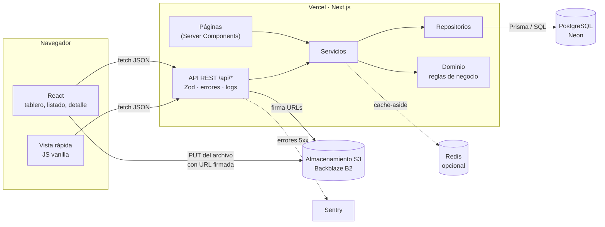
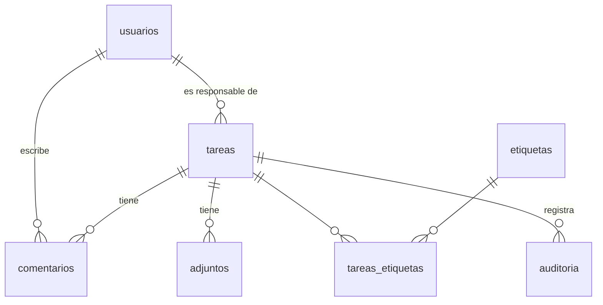

# Gestor de Tareas

[](https://github.com/alosadasei/gestor-tareas/actions/workflows/ci.yml)
[](https://github.com/alosadasei/gestor-tareas/actions/workflows/despliegue.yml)

Tablero kanban ligero para organizar el trabajo de un equipo: cada tarea tiene estado, prioridad, responsable, fecha límite, etiquetas, comentarios y archivos adjuntos. Es una aplicación fullstack completa: frontend en React, API REST, base de datos PostgreSQL, tests automáticos, integración continua y despliegue público.

**Pruébala:** https://gestor-tareas-blush.vercel.app

| | |
|---|---|
| [Tablero](https://gestor-tareas-blush.vercel.app/tablero) | Columnas Pendiente / En curso / Hecha. Arrastrar una tarjeta (con ratón o teclado) cambia su estado. |
| [Listado](https://gestor-tareas-blush.vercel.app/tareas) | Tabla con paginación, filtros y ordenación, todo guardado en la URL. |
| [Detalle de una tarea](https://gestor-tareas-blush.vercel.app/tareas/1) | Edición, comentarios (quién y cuándo) y adjuntos. |
| [Vista rápida](https://gestor-tareas-blush.vercel.app/vista-rapida.html) | La misma API desde una página en JavaScript sin frameworks. |
| [Documentación de la API](https://gestor-tareas-blush.vercel.app/api/docs) | OpenAPI interactivo, generado desde los esquemas de validación. |

Proyecto final del curso *Desarrollo Web Full Stack con IA* (Tokio School).

## Índice

- [Funcionalidad](#funcionalidad)
- [Arquitectura](#arquitectura)
- [Ejecutarla en local](#ejecutarla-en-local)
- [Tests y calidad](#tests-y-calidad)
- [Despliegue](#despliegue)
- [Decisiones técnicas](#decisiones-técnicas)
- [Estructura del repositorio](#estructura-del-repositorio)
- [Glosario](#glosario)
- [Uso de IA](#uso-de-ia)
- [Retrospectiva](#retrospectiva)

## Funcionalidad

- **Tareas:** crear, ver, editar y borrar, con título, descripción, estado, prioridad, fecha límite, responsable y etiquetas. El borrado es lógico (*soft delete*) y cada cambio queda registrado en una tabla de auditoría.
- **Tablero kanban:** columnas por estado con *drag & drop*, también por teclado y con anuncios para lectores de pantalla.
- **Listado:** paginación, filtros (texto, estado, prioridad, responsable) y ordenación.
- **Comentarios** en cada tarea, con autor y fecha.
- **Adjuntos** (imágenes, PDF, texto, CSV; hasta 10 MB): el navegador los sube directamente al almacenamiento con una URL firmada. En la base de datos solo se guarda la referencia.
- **Estadísticas** del tablero con caché *cache-aside* en Redis.
- **Responsive y accesible:** mobile-first, tema claro y oscuro, navegación por teclado y auditoría automática con axe (WCAG 2.2 AA).

No hay autenticación (es un reto opcional del proyecto). El responsable de una tarea y el autor de un comentario se eligen entre los usuarios de ejemplo.

## Arquitectura

Una sola aplicación **Next.js** (App Router) contiene el frontend y la API, y se despliega en **Vercel**. Los datos viven en **PostgreSQL** (Neon), los adjuntos en un almacenamiento compatible con **S3** y la caché, opcional, en **Redis**.



### Capas del backend

Cada petición atraviesa las mismas capas, y cada una solo conoce a la de debajo:

1. **Ruta** ([src/app/api](src/app/api)): fina. Valida la entrada con Zod, llama a un servicio o repositorio y devuelve JSON. Todas pasan por [`conManejoErrores`](src/api/manejador.ts), que asigna un *request id*, registra la petición y traduce cualquier error al formato común.
2. **Servicios** ([src/services](src/services)): casos de uso que combinan varias piezas, como cargar el detalle de una tarea con sus comentarios y adjuntos, o las estadísticas con caché.
3. **Dominio** ([src/domain](src/domain)): entidades y reglas de negocio en TypeScript puro, sin base de datos ni HTTP. Por ejemplo, un título no puede estar vacío y la fecha límite no puede estar en el pasado.
4. **Repositorios** ([src/repositorios](src/repositorios)): acceso a datos detrás de una interfaz ([`TareaRepositorio`](src/domain/tareaRepositorio.ts)). Hay una implementación con Prisma y otra en memoria para tests.

[src/api/dependencias.ts](src/api/dependencias.ts) es el único sitio donde se decide qué implementación usa cada ruta.

### API REST

16 endpoints, más la especificación OpenAPI (`/api/openapi.json`) y su documentación interactiva ([/api/docs](https://gestor-tareas-blush.vercel.app/api/docs)):

| Método y ruta | Qué hace |
|---|---|
| `GET /api/tareas` | Listado paginado, con filtros y orden |
| `POST /api/tareas` | Crea una tarea (201) |
| `GET /api/tareas/{id}` | Detalle de una tarea |
| `PATCH /api/tareas/{id}` | Edita campos de una tarea |
| `DELETE /api/tareas/{id}` | Borrado lógico (204) |
| `PATCH /api/tareas/{id}/estado` | Cambia de columna |
| `GET /api/tareas/{id}/comentarios` | Comentarios de una tarea |
| `POST /api/tareas/{id}/comentarios` | Añade un comentario |
| `POST /api/tareas/{id}/adjuntos/subida` | Pide una URL firmada para subir un archivo |
| `GET /api/tareas/{id}/adjuntos` | Adjuntos, con URL de descarga firmada |
| `POST /api/tareas/{id}/adjuntos` | Registra un adjunto ya subido |
| `DELETE /api/adjuntos/{id}` | Borra un adjunto |
| `GET /api/usuarios` · `GET /api/etiquetas` | Catálogos |
| `GET /api/estadisticas` | Resumen del tablero (con caché) |
| `GET /api/health` | Health check: 200 si la base de datos responde, 503 si no |

Todos los errores tienen la misma forma, con el *request id* que también aparece en los logs y en Sentry:

```json
{ "error": { "code": "VALIDACION", "message": "Los datos enviados no son válidos",
             "details": [{ "campo": "titulo", "mensaje": "…" }], "requestId": "239882cc-…" } }
```

### Base de datos

7 tablas con integridad referencial ([prisma/schema.prisma](prisma/schema.prisma)):



- **Migraciones versionadas** en [prisma/migrations](prisma/migrations) y un **seed reproducible** ([prisma/seed.ts](prisma/seed.ts)).
- **Tres consultas en SQL puro** ([consultasSql.ts](src/repositorios/consultasSql.ts)), analizadas con `EXPLAIN ANALYZE` antes y después de crear índices. Una de ellas pasa de 16,7 s a 4 ms con 200.000 tareas; los detalles están en [docs/sql-explain.md](docs/sql-explain.md).
- **Test anti N+1** ([nMasUno.integracion.test.ts](src/repositorios/nMasUno.integracion.test.ts)): el listado hace el mismo número de consultas con 5 tareas que con 50.

## Ejecutarla en local

**Requisitos:** Node.js 22 o superior, Docker con Docker Compose v2 y Git.

```bash
git clone https://github.com/alosadasei/gestor-tareas.git
cd gestor-tareas
./setup.sh
npm run dev        # → http://localhost:3000
```

[`setup.sh`](setup.sh) deja el entorno listo y se puede ejecutar varias veces sin romper nada:

1. Comprueba Node, npm y Docker, y avisa si falta algo o Docker no está en marcha.
2. Instala las dependencias (`npm ci`) y genera el cliente de Prisma.
3. Crea `.env.local` a partir de [.env.example](.env.example) con los valores locales. Si ya existe, no lo toca.
4. Levanta PostgreSQL, Redis y un simulador de S3 con `docker compose`, avisando antes si algún puerto está ocupado.
5. Aplica las migraciones y carga los datos de ejemplo. Al repetirlo pregunta antes, porque el seed vacía las tablas.

Si algún puerto está ocupado, se pueden usar otros: `POSTGRES_PORT=5433 ./setup.sh`.

<details>
<summary>Sin setup.sh, paso a paso</summary>

```bash
npm ci
cp .env.example .env.local   # y rellena DATABASE_URL, TEST_DATABASE_URL, STORAGE_*… (los valores locales están en los comentarios)
docker compose up -d --wait
npm run db:deploy            # migraciones
npm run db:seed              # datos de ejemplo (vacía las tablas)
npm run dev
```

</details>

### Scripts

| Comando | Qué hace |
|---|---|
| `npm run dev` | Servidor de desarrollo |
| `npm run build` · `npm start` | Build de producción y arrancarlo |
| `npm test` | Tests unitarios y de integración |
| `npm run test:coverage` | Lo mismo, con informe de cobertura (umbral: 60 %) |
| `npm run test:e2e` | Tests e2e con Playwright (antes, una vez: `npx playwright install chromium`) |
| `npm run lint` · `npm run typecheck` | oxlint y TypeScript |
| `npm run db:migrate` | Crea una migración nueva a partir de cambios en el schema |
| `npm run db:seed` | Recarga los datos de ejemplo |
| `npm run db:studio` | Explorador visual de la base de datos |

## Tests y calidad

| Tipo | Herramienta | Qué cubre |
|---|---|---|
| Unitarios | Vitest + Testing Library | Dominio, utilidades, validación, componentes de React |
| Integración | Vitest contra PostgreSQL y Redis reales | Repositorios, endpoints de la API, contrato OpenAPI, caché, N+1 |
| E2E | Playwright + axe-core | Flujo completo de una tarea, filtros, vista rápida y accesibilidad en escritorio y móvil, tema claro y oscuro |

La cobertura ronda el **90 %** (el umbral de la CI es el 60 %). Los tests de integración usan una base de datos propia que se vacía en cada test y cuyo nombre debe contener `test`. Así es imposible vaciar por error la de desarrollo.

**Integración continua** ([ci.yml](.github/workflows/ci.yml)): en cada Pull Request se ejecutan lint y tipos, el build de producción, los tests con cobertura en Node 22 y 24, y los e2e. Un ruleset de GitHub impide mergear en `main` sin todos en verde.

## Despliegue

```text
PR con la CI en verde ──► merge a main ──► Vercel: migraciones + build ──► smoke test de producción
```

- **Vercel** despliega cada merge a `main` en producción y cada rama en una URL de preview.
- Antes de compilar, [scripts/vercel-build.sh](scripts/vercel-build.sh) aplica las migraciones pendientes. Si una falla, no se publica la versión nueva.
- **Neon** aloja PostgreSQL y no se pausa. **Backblaze B2** guarda los adjuntos (con la API compatible con S3, así que también valdría Cloudflare R2).
- Después de cada despliegue, [despliegue.yml](.github/workflows/despliegue.yml) espera a que Vercel termine y comprueba que la app responde: health check, páginas y API ([scripts/comprobar-despliegue.sh](scripts/comprobar-despliegue.sh)).
- Los secretos solo están en las variables de entorno de cada entorno (desarrollo, preview y producción). Se validan con Zod al arrancar: si falta una obligatoria, el servidor no arranca y el log dice cuál es.

Guía completa: [docs/despliegue.md](docs/despliegue.md) · Variables por entorno: [MAPA-ENTORNOS.md](MAPA-ENTORNOS.md) · Qué hacer si algo falla: [MONITORING.md](MONITORING.md).

## Decisiones técnicas

| Decisión | Por qué | Qué descarté |
|---|---|---|
| **Next.js con frontend y API en el mismo proyecto** | Un solo repositorio, un solo despliegue y tipos compartidos entre cliente y servidor. Las páginas cargan los datos en el servidor y llegan ya pintadas. | Un backend Express aparte: dos despliegues y duplicar tipos sin ganar nada a este tamaño. |
| **Capas (dominio, repositorios, servicios, rutas)** | Las reglas de negocio se prueban sin base de datos, y cambiar Prisma por otra cosa solo afecta a los repositorios. | Llamar a Prisma desde las rutas: más rápido de escribir, pero imposible de probar por partes. |
| **Prisma, más SQL puro donde hace falta** | Prisma da tipos y migraciones. Las tres agregaciones van en SQL porque con el ORM serían varias consultas o cálculos en memoria. | Solo ORM o solo SQL. |
| **Zod como fuente única de validación y de OpenAPI** | Los mismos esquemas validan la entrada y generan la documentación, así que no pueden contradecirse. Un test comprueba que las respuestas reales cumplen el contrato. | Escribir el OpenAPI a mano: se desincroniza con el primer cambio. |
| **Errores de dominio frente a errores técnicos** | Un error de dominio (validación, no encontrado, conflicto) es culpa de la petición: 4xx con un mensaje útil. Uno técnico es nuestro: 500 genérico al cliente y el detalle completo al log y a Sentry, enlazados por *request id*. | Devolver el mensaje de la excepción: filtra detalles internos. |
| **Adjuntos con URL firmada** | El archivo va del navegador al almacenamiento sin pasar por el servidor (las funciones de Vercel limitan el tamaño del cuerpo). El tipo y el tamaño van dentro de la firma, así que no se puede subir otra cosa. | Subir a través de la API o guardar el archivo en la base de datos. |
| **Borrado lógico y auditoría** | Borrar una tarea no destruye sus datos (solo se marca con `borrada_en`), y la auditoría guarda qué cambió en cada tarea, con el valor anterior y el nuevo, y cuándo. | Borrado físico: un borrado por error no tendría vuelta atrás. |
| **Caché *cache-aside* solo en estadísticas, y opcional** | Es el único endpoint costoso: agrega todo el tablero. Si Redis no está, la app funciona igual, solo que más lenta. En producción no hay Redis. | Cachear todo o hacer Redis obligatorio: más complejidad y un punto de fallo más. |
| **Tests de integración contra PostgreSQL real** | Los *mocks* del ORM no detectan errores de SQL, de índices ni de N+1. | Simular Prisma en los tests. |
| **Accesibilidad desde el principio** | `<dialog>` nativo para los modales, *drag & drop* con teclado y anuncios (dnd-kit), y axe en los e2e para que no haya regresiones. | Revisar la accesibilidad al final. |
| **Neon y Vercel** | Planes gratuitos. Neon no pausa la base de datos (la de Supabase sí, tras una semana sin uso). | Supabase, Railway. |
| **Sin autenticación** | Es opcional en el proyecto; preferí un MVP sólido y bien probado a un opcional a medias. | — |

## Estructura del repositorio

```text
src/
  app/            Páginas (Next.js App Router) y rutas de la API (app/api)
  api/            Infraestructura de la API: validación, manejo de errores, OpenAPI, dependencias
  domain/         Entidades, reglas de negocio e interfaz del repositorio
  repositorios/   Acceso a datos: Prisma, SQL puro, versión en memoria
  services/       Casos de uso (tablero, detalle, estadísticas con caché)
  componentes/    Componentes de React (tablero, detalle, diálogos, avisos)
  cliente/        Cliente de la API para el navegador y lógica de las pantallas
  utils/          Funciones reutilizables sobre tareas
lib/              Base de datos, entorno, logger, caché, almacenamiento, health check
prisma/           Schema, migraciones y seed
public/           Vista rápida en JS vanilla
tests/            Tests de integración de la API y de los servicios
e2e/              Tests de Playwright
scripts/          Build de Vercel, smoke test, CORS del almacenamiento, SQL de EXPLAIN
docs/             Despliegue, análisis SQL, uso de IA y prácticas del curso
```

## Glosario

| Término | Qué es | En este proyecto |
|---|---|---|
| **Cliente / servidor** | El cliente (el navegador) pide recursos; el servidor los prepara y responde. | El navegador pinta la interfaz; Vercel ejecuta Next.js y la API. |
| **HTTP** | Protocolo de petición y respuesta de la web: método, ruta, cabeceras y cuerpo. | Toda la comunicación con la API. |
| **Código de estado** | Número de la respuesta HTTP que dice cómo fue la petición (2xx bien, 4xx error del cliente, 5xx error del servidor). | 201 al crear, 204 al borrar, 400 validación, 404 no encontrado, 503 health check degradado. |
| **DNS** | Sistema que traduce un nombre de dominio a la dirección IP del servidor. | `gestor-tareas-blush.vercel.app` apunta a los servidores de Vercel. |
| **API REST** | Interfaz que expone recursos en URLs y opera sobre ellos con métodos HTTP. | `/api/tareas`, `/api/tareas/{id}/comentarios`… |
| **JSON** | Formato de texto para intercambiar datos estructurados. | Cuerpo de todas las peticiones y respuestas de la API. |
| **Endpoint** | Combinación concreta de método y ruta de una API. | `PATCH /api/tareas/{id}/estado`. |
| **Validación** | Comprobar que los datos de entrada tienen la forma y los límites esperados antes de usarlos. | Esquemas de Zod en [src/api/esquemas.ts](src/api/esquemas.ts). |
| **ORM** | Librería que traduce entre objetos del lenguaje y tablas de la base de datos. | Prisma. |
| **Migración** | Cambio versionado del esquema de la base de datos, aplicable en orden en cualquier entorno. | [prisma/migrations](prisma/migrations). |
| **Seed** | Script que carga datos iniciales conocidos. | [prisma/seed.ts](prisma/seed.ts): 3 usuarios, 8 tareas… |
| **Integridad referencial** | Garantía de que una clave foránea siempre apunta a una fila que existe. | No se puede borrar un usuario que es responsable de tareas. |
| **Índice** | Estructura que permite a la base de datos encontrar filas sin leer la tabla entera. | Índices de la migración `indices`, medidos con `EXPLAIN`. |
| **Problema N+1** | Hacer una consulta por cada elemento de una lista en vez de unas pocas para todos. | Test que cuenta las consultas del listado. |
| **Caché *cache-aside*** | La aplicación busca primero en la caché y, si no está, calcula, guarda y devuelve. | Estadísticas en Redis durante 60 s, invalidadas al cambiar una tarea. |
| **URL firmada** | URL temporal con una firma criptográfica que da permiso para una única operación. | Subida y descarga de adjuntos. |
| **CORS** | Regla del navegador que impide llamar a otro origen salvo que este lo permita. | El bucket de adjuntos permite el `PUT` desde la app. |
| **Variable de entorno** | Configuración que se da al proceso desde fuera del código, distinta en cada entorno. | `DATABASE_URL`, `STORAGE_*`… nunca en el repositorio. |
| **CI/CD** | Integración continua (probar cada cambio automáticamente) y despliegue continuo (publicarlo automáticamente). | GitHub Actions y Vercel. |
| **Test e2e** | Prueba que usa la aplicación como lo haría una persona, de principio a fin, en un navegador real. | Playwright: crear, mover, comentar y borrar una tarea. |

## Uso de IA

En [docs/ai-usage.md](docs/ai-usage.md) se recoge qué herramientas de IA he usado, para qué, qué datos no envío nunca a modelos externos y la retrospectiva del curso. Las prácticas del módulo de herramientas de IA están en [docs/ejercicios](docs/ejercicios).

## Retrospectiva

Qué salió bien, qué me costó y qué haría distinto: [docs/retrospectiva.md](docs/retrospectiva.md).
